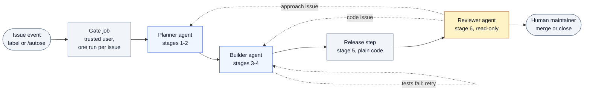

# Component view

Status: design draft, written before any agent code.
Model choices and their free-tier limits are recorded in ADR-006.

Solid arrows are forward flow. Dashed arrows send work back and are limited
by budgets (ADR-002, ADR-009).

## Components

| Component | Stages | Tools | Model | Can write to GitHub? |
| --- | --- | --- | --- | --- |
| Gate job | trigger check | none | none | no |
| Planner agent | 1 Requirements, 2 Design | read repo, write `spec.md` and `design.md` | Gemini (Flash-class) | no |
| Builder agent | 3 Implementation, 4 Testing | read, edit `src/` and `tests/`, run tests | Groq gpt-oss-120b | no |
| Release step | 5 Release | `git push`, `gh pr create` (plain code) | none | yes |
| Reviewer agent | 6 Review | read, run code and tests | Groq qwen3.8-27b (third family) | no (a separate posting step publishes the review) |

## Reading guide
- Checks between stages are deterministic code, not a model (ADR-007).
- Artifacts (`spec.md`, `design.md`, `diff.patch`, `test_report.md`, `pr.md`,
  `review.md`, `run_state.json`) are stored as workflow artifacts (ADR-004).
- Agents hold no GitHub token; only the Release and posting steps can write
  (ADR-005).
- The Reviewer receives only the issue, the diff and the repository at the PR
  head commit (ADR-003, ADR-008).
- A human makes the merge decision; no component merges.
